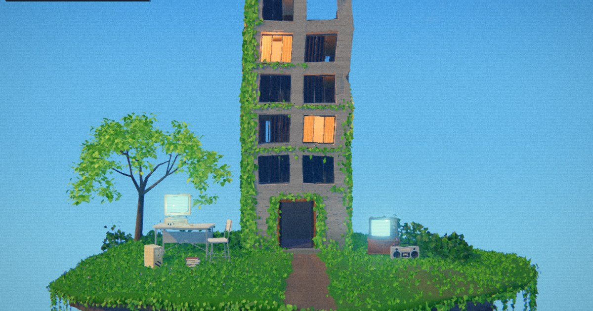

# SILICON DREAMS

**Silicon Dreams** is a browser-based interactive 3D dreamcore and psychological horror prototype inspired by late-1990s digital environments and classic Windows 95 interfaces.

**Live preview:** https://silicon-dreams-six.vercel.app/

## Preview



## Current Features

- **Real-time 3D WebGPU / TSL rendering:** Built with `Three.js` `WebGPURenderer` and automatic `WebGL2` fallback, showing the active backend (`WebGPU · TSL` or `WebGL2 · TSL`) in the HUD.
- **Day & Night modes:** Switch between bright dreamcore twilight (`Día`) and liminal psychological horror (`Noche`), or boot directly into Night mode with `?mode=night`. Includes a Win95-styled transition dialog (`signal.exe`), lazy-loaded night geometry/textures/mist/backdrop, and Night controls for CRT state, TV state, low mist, and eyes/cobwebs.
- **Custom TSL shaders & post-processing pipeline:** Procedural concrete, terrain, foliage, glass, CRT/TV screens, sky dome, and clouds paired with `Eco`, `Balanced`, and `Ultra` quality presets, optional GTAO, Bloom & Halation, FXAA, and 15 Hz analog tape film grain.
- **Camera exploration:** Interactive `OrbitControls` (with coarse-pointer mobile sensitivity adjustments), 11 Day presets, 4 Night close-up presets, smooth cubic preset transitions, and a 360° auto-orbit toggle.
- **Compressed 3D assets & draw-call optimization:** Draco-compressed `.glb` models decoded locally from `public/draco/`, combined with GPU-instanced foliage and static mesh merging (`SD_Merged_Static`).
- **Windows 95 HUD:** Responsive desktop taskbar and mobile layout (UI currently authored in Spanish).

## Technical Stack

- **3D & Shaders:** `three` (`^0.186.0` — `three/webgpu` and `three/tsl`)
- **Language & Tooling:** TypeScript (`^5.8.3`, `strict: true`), Vite (`^6.3.5`)
- **Geometry Compression:** Local Draco decoder (`public/draco/`)
- **Unit Testing:** Node native test execution (`node --experimental-strip-types tests/grain-clock.test.ts`)
- **Hosting:** Vercel (`vercel.json`)

## Running Locally

Requires **Node.js 22.6+** if running `npm test` (uses `--experimental-strip-types`).

```bash
npm install
npm run dev
```

Available scripts from `package.json`:

- `npm run dev` — Start the Vite development server (default port `5186`)
- `npm run build` — Run `tsc --noEmit` followed by `vite build`
- `npm run preview` — Serve the production `dist/` build locally
- `npm test` — Run unit tests (`tests/grain-clock.test.ts`)

Append `?mode=night` to the local URL to boot directly in Night mode.

## Project Structure

```text
.
├── index.html                  # Document head, SEO/OG metadata, and Win95 HUD markup/styles
├── package.json                # Scripts and dependencies (three, typescript, vite)
├── tsconfig.json               # Strict TypeScript compiler configuration
├── vite.config.ts              # Vite build config and Three.js manual chunking
├── vercel.json                 # Vercel Vite build and security/cache headers
├── public/
│   ├── draco/                  # Local Draco JS/WASM decoder files
│   ├── models/                 # silicon-dreams-v1.glb, clouds-v1.glb, night-extras-v1.glb
│   ├── screens/                # Night CRT/TV/eye PNG textures
│   ├── og-preview.jpg          # Social preview image
│   ├── scene-meta.json         # Day cameras, lights, and orbit metadata
│   └── night-meta.json         # Night cameras, lights, mist bounds, and screen bounds
├── scripts/
│   ├── export_scene.py         # Blender scene export script
│   └── export_night.py         # Blender night-extras export script
├── src/
│   ├── main.ts                 # Entry point: renderer, loader, lighting, cameras, Day/Night, UI
│   ├── pipeline.ts             # TSL post-processing pipeline (GTAO, bloom, FXAA, 15 Hz grain)
│   ├── mode-transition.ts      # Win95-style Day/Night transition dialog controller
│   ├── mode-transition.css     # Transition dialog styling
│   ├── types.ts                # Metadata and state TypeScript interfaces
│   └── shaders/
│       ├── materials.ts        # Procedural TSL materials, mesh merging, night extras
│       ├── sky.ts              # Sky dome, clouds, PMREM environments, night mist & backdrop
│       └── noise.ts            # Shared procedural noise & TSL color-ramp helpers
└── tests/
    └── grain-clock.test.ts     # Unit test verifying 15 Hz film grain cadence
```

## Current Development Priorities

The next engineering milestone focuses on making the existing 3D web prototype more reliable, navigable, interactive, maintainable, and testable:

- [#1](https://github.com/PA-Analytics/silicon-dreams/issues/1) — Harden 3D runtime reliability, asset loading progress, and error recovery
- [#2](https://github.com/PA-Analytics/silicon-dreams/issues/2) — Harden camera navigation, movement bounds, view reset, and resize handling
- [#3](https://github.com/PA-Analytics/silicon-dreams/issues/3) — Add minimal reusable 3D hotspot interaction system with keyboard accessibility
- [#4](https://github.com/PA-Analytics/silicon-dreams/issues/4) — Modularize Day/Night mode state and transitions out of `src/main.ts`
- [#5](https://github.com/PA-Analytics/silicon-dreams/issues/5) — Add Playwright browser smoke tests with headless GPU fallback handling
- [#6](https://github.com/PA-Analytics/silicon-dreams/issues/6) — Add GitHub Actions CI workflow and Vercel configuration verification

## Development Status

Silicon Dreams is an active, early-stage interactive 3D prototype — not a finished game. The items listed under **Current Development Priorities** are planned engineering tasks tracked in GitHub Issues and are not yet implemented in `main`.
